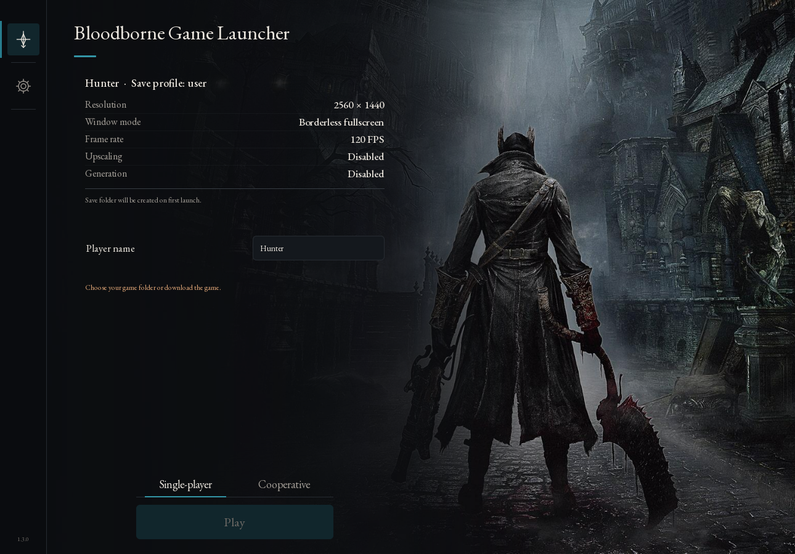
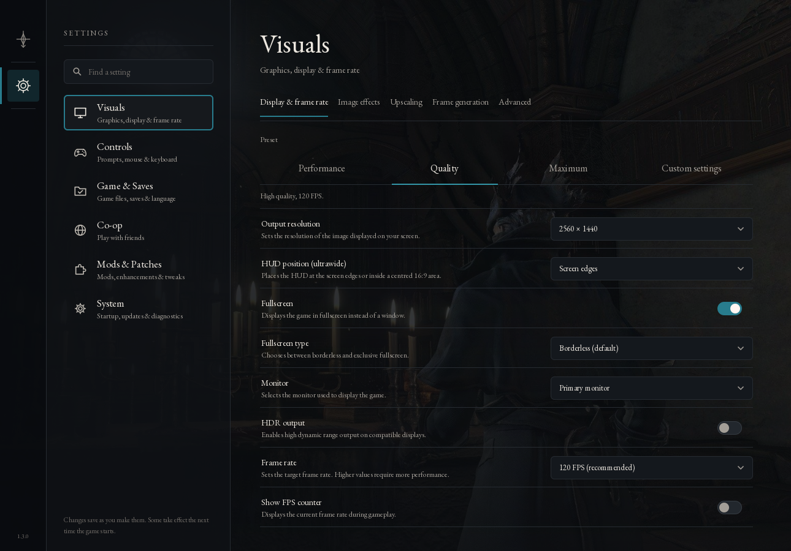
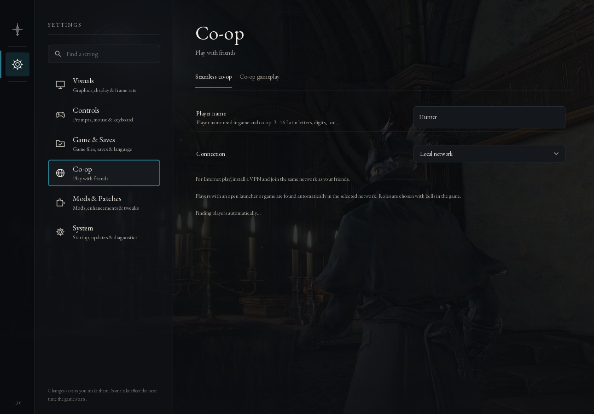
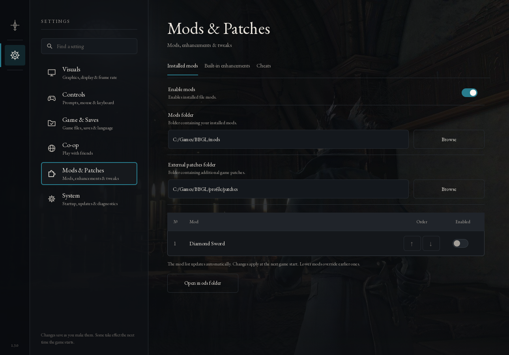

# Bloodborne Game Launcher (BBGL)

**English** · [Русский](README.ru.md) · [Download BBGL](https://github.com/mark3317/bbgl/releases/latest) · [Report a problem](https://github.com/mark3317/bbgl/issues)

**Bloodborne for Windows, focused on convenience and playing through the game with friends.** BBGL is a fork of [yharnam-pc](https://github.com/Jgamrot/yharnam-pc), created to make getting into the game easier, especially in co-op. Game downloading is built into the launcher, and the modified **[BBSC-GL](https://github.com/mark3317/bbsc-gl)** distributed P2P co-op client is bundled. After downloading BBGL, you do not need to find separate mod, loader or server packages and match their versions yourself.

## Why this fork exists

BBGL brings installation, configuration and launching into one interface. Guided setup helps prepare the game, choose a save folder and configure co-op. Play alone or gather friends without manually installing DLLs or assembling separate BBSC components.

**The entire main story is playable in co-op, from the beginning through the finale, with a working transition to NG+. A complete playthrough and the move into the next cycle have been tested in-game and confirmed by the user. Chalice dungeons work in co-op, including randomly generated Root Chalices.**

In **1.3.0**, hunters can travel independently and meet again in the same party. The update also reworks native NPC synchronization, Chalice lamps and progress, and the transition from a shared ending to separate worlds. [Release notes and known limits](docs/release-1.3.0.md).

## Co-op: changes from BBSC

BBSC-GL builds on [Bloodborne Seamless Co-op](https://github.com/CLSAMG22/BBSC). Seamless sessions, networking and the underlying co-op mechanics were created by the original authors. This fork extends that foundation for playing through the game together:

- **Complete main campaign and NG+.** The main game has been fully tested as a co-op playthrough through the finale, including the transition to the next NG cycle.
- **Personal quests, shared main story.** Each player keeps their own NPC quest progress and personal rewards, while main-story progress is synchronized across the party. Play together while retaining your own character and world.
- **Working chalices with random generation.** Explore story chalices and randomly generated Root Chalices together. The game creates the Root Chalice layout; guests load the same dungeon as the host. Different rituals and layouts remain distinct, and created dungeon data persists between launches. Guests keep their own altars and progress without having to create a matching chalice first.
- **Return to your own world.** Guest exit, world recovery and return locations have been improved, including after visiting the host's chalice dungeon.
- **Personal interactions and rewards.** Extended guest NPC interactions and personal quest-item grants, with a personal Hunter’s Dream for every hunter.
- **Fixes to the original mod.** Addressed repeat-summon and stale-session issues, chalice combat latency, guest return problems and the camera after a party wipe. Death handling and guest menu exit have also been improved. Keys and tools come from personal game sources rather than the host inventory; loot and rewards use native delivery with personal conditions.

A complete main-story co-op playthrough and transition to NG+ were confirmed by the user on 5 November 2026. Co-op chalice exploration and random generation are supported. Coverage of every additional rite, reward edge case and party composition is still being expanded. [BBSC-GL source and development status](https://github.com/mark3317/bbsc-gl/tree/develop).

## BBGL features

- **One package for getting started.** Built-in game downloading, bundled P2P co-op client, and ready-to-use button prompt packs. Game files are downloaded separately through the interface and are not included in the launcher ZIP.
- **Full Russian interface localization.** The launcher, added in-game menus and overlay are translated into Russian; English is also available.
- **Graphics settings during gameplay.** Change resolution, upscaling and supported graphics effects through the in-game menu without restarting the game, so you can tune image quality and performance during a session.
- **Redesigned interface.** Guided first launch, settings search, solo/co-op launch selection and LAN/VPN connection checks from the launcher.
- **Mod management.** One table for load order, toggles, network comparison and missing-mod downloads, with a mismatch warning before launch. Button prompts stay separate. The optional Diamond Sword mod is bundled and disabled by default.
- **In-game overlay.** Open trophies, map options and diagnostics with **Insert** or **L3 + R3**. The overlay follows the launcher's language.
- **Included control prompts.** PlayStation, Xbox and keyboard prompts, with the alternative packs already bundled.
- **Profile stored separately.** Settings, launcher-managed saves and co-op data live in `%LOCALAPPDATA%\Bloodborne Game Launcher`. Manually selected save folders stay where you chose them.

Bundled mod and P2P integration, personal versus main-story progress, seamless chalice play, Russian in-game menus and expanded live graphics controls are key additions in this fork. Features inherited from the original port and BBSC remain credited to their authors.

## Launcher

The redesigned interface supports English and Russian. Screenshots show the English interface.

## Start playing

1. Download `bbgl-1.3.0-windows-x64.zip` from Releases and extract it. Open the **Bloodborne Game Launcher** folder.
2. Run **Bloodborne.exe**. Use the built-in download button in setup or select an existing Bloodborne **CUSA03173, update 1.09** folder. Game files are not included in the launcher archive.
3. For co-op, connect every PC to the same VPN or LAN. Choose **Local network**, **Tailscale** or **Radmin**; installed VPNs appear in the list and missing ones have installation buttons. Check connectivity, then start the game. Players can join later. No server or invite code is required.
4. Use the in-game co-op bells to gather your party. Keep everyone on the same BBGL release.

Windows x64 and a compatible Vulkan driver are required. For graphics, hardware, controls, extracting your game and other port details, use the **[original yharnam-pc README](https://github.com/Jgamrot/yharnam-pc#readme)**.

## Source and credits

[Build BBGL](BUILDING.md) · [Changes](CHANGELOG.md) · [Credits and licences](THIRD_PARTY.md)

`main` is the release source; `develop` is ongoing work. BBSC-GL is pinned as a submodule. Internal `bbport` / `bbsc` executable names and protocol identifiers are retained for compatibility.

Based on yharnam-pc / bbport and [BBSC by CLS_AMG and contributors](https://github.com/CLSAMG22/BBSC). Their licences and attribution remain included. Bloodborne belongs to FromSoftware and Sony Interactive Entertainment; this is an independent fan project.
