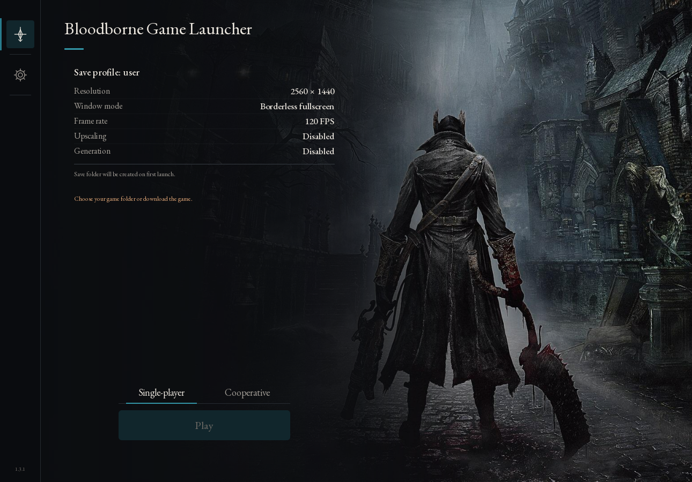
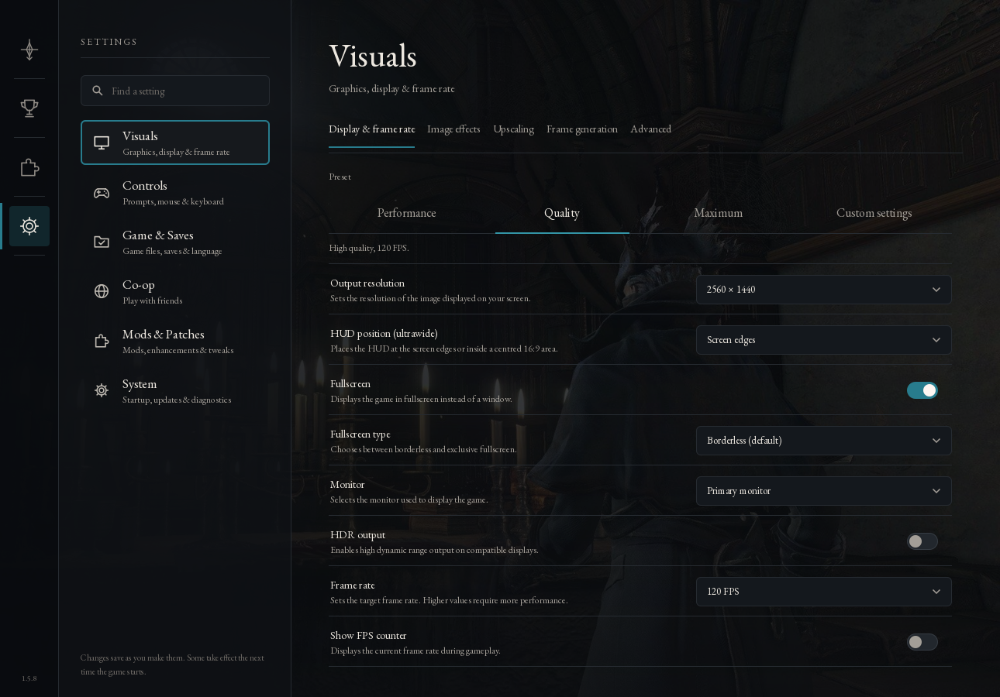
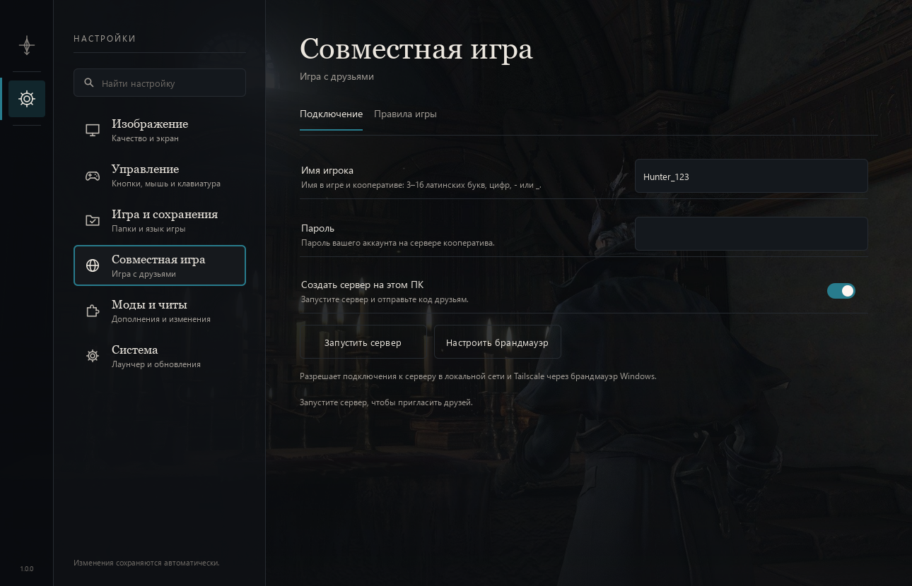
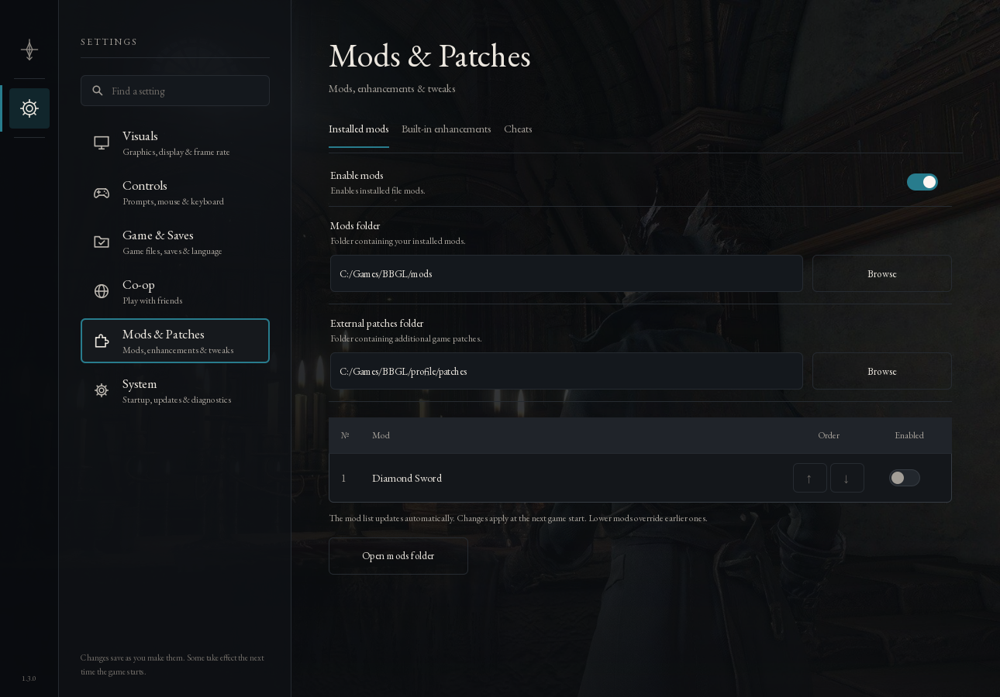

# Bloodborne Game Launcher (BBGL)

[English](README.md) · **Русский** · [Скачать BBGL](https://github.com/mark3317/bbgl/releases/latest) · [Сообщить о проблеме](https://github.com/mark3317/bbgl/issues)

**Bloodborne для Windows с упором на удобство и совместное прохождение.** BBGL — форк [yharnam-pc](https://github.com/Jgamrot/yharnam-pc), созданный, чтобы подготовка к игре, особенно с друзьями, занимала меньше времени. Загрузка игры встроена в лаунчер, а доработанный мод **[BBSC-GL](https://github.com/mark3317/bbsc-gl)** с распределённым P2P уже включён в комплект. После скачивания лаунчера не нужно отдельно искать мод, загрузчик, сервер или наборы файлов и вручную совмещать их версии.

## Зачем создан форк

BBGL объединяет установку, настройку и запуск игры в одном интерфейсе. Мастер помогает подготовить игру, выбрать папку сохранений и настроить кооператив. Можно играть одному или собрать друзей, не занимаясь ручной установкой DLL и настройкой отдельных компонентов BBSC.

**Основной сюжет полностью проходится в кооперативе — от начала до финала, с рабочим переходом в NG+. Полное прохождение и переход в следующий цикл проверены в игре и подтверждены пользователем. Чаши работают в совместной игре, включая случайно генерируемые корневые подземелья.**

В **1.3.0** каждый охотник может зажигать и использовать лампы, перемещаться самостоятельно и снова встречаться с напарниками в той же сессии. У каждого свои чаши и алтари. Гости могут помогать проходить случайно сгенерированное подземелье владельца и получать свои награды. [Изменения и открытые проверки](docs/release-1.3.0.md).

## Party и децентрализованный кооператив

BBGL использует **Party** — децентрализованную систему прямого обмена данными между компьютерами игроков. Party запускается локально у каждого участника, находит напарников в общей локальной сети или VPN и использует прямое P2P-соединение игры по UDP. Призывающий игрок координирует игровую сессию со своего ПК. Отдельный сервер, серверный аккаунт и код приглашения не нужны.

## Кооператив: что изменено относительно BBSC

За основу взят [Bloodborne Seamless Co-op](https://github.com/CLSAMG22/BBSC). Бесшовные сессии, сетевой обмен и базовые механики совместной игры созданы авторами оригинала. BBSC-GL развивает эту основу для полноценного совместного прохождения:

- **Полная сюжетная кампания и NG+.** Основная игра полностью проверена на совместное прохождение до финала; переход в следующий NG-цикл работает.
- **Личные квесты, общий основной сюжет.** У каждого участника остаются собственные квесты NPC и личные награды, а прогресс основного сюжета синхронизируется между участниками. Можно проходить игру вместе, сохраняя самостоятельность своего персонажа и мира.
- **Рабочие чаши и случайная генерация.** Можно вместе проходить сюжетные чаши и случайные корневые подземелья. Раскладку корневой чаши создаёт сама игра, гости исследуют ту же локацию хоста. Разные ритуалы и раскладки учитываются отдельно, данные созданных чаш сохраняются между запусками. Свои алтари и личный прогресс гости сохраняют; заранее создавать такую же чашу у себя не требуется.
- **Возвращение в собственный мир.** Доработаны выход гостя, восстановление его мира и точки возвращения после игры у хоста, в том числе после посещения чаш.
- **Личные взаимодействия и награды.** Расширены взаимодействия гостей с NPC и выдача личных квестовых предметов. У каждого охотника свой Сон.
- **Исправления оригинального мода.** Исправлены проблемы повторного призыва и очистки старых записей сессии, задержки боя в чашах, возврата гостя и камеры после гибели группы. Доработаны смерть и выход через меню. Ключи, значки и инструменты получают лично; инвентарь хоста не копируется. Добыча и награды используют штатную выдачу игры с личными условиями.

Полное прохождение основной сюжетной игры и переход в NG+ подтверждены пользователем 5 ноября 2026 года. Совместное прохождение чаш и их случайная генерация поддерживаются. Проверка всех дополнительных обрядов, редких сценариев наград и составов группы продолжается. [Исходники и статус BBSC-GL](https://github.com/mark3317/bbsc-gl/tree/develop).

## Удобство и возможности BBGL

- **Всё необходимое для запуска в одном комплекте.** Встроенная загрузка игры, клиент кооператива P2P и готовые наборы подсказок кнопок. Файлы игры загружаются отдельно через интерфейс и не входят в ZIP лаунчера.
- **Полная русская локализация интерфейса.** Лаунчер, добавленные игровые меню и оверлей переведены на русский; английский язык также доступен.
- **Графика прямо в игре.** Разрешение, масштабирование и поддерживаемые графические эффекты можно менять в игровом меню без перезапуска игры — удобно подбирать изображение и производительность во время сессии.
- **Обновлённый интерфейс.** Мастер первого запуска, поиск настроек, выбор одиночного или совместного режима, сети и проверка связи между участниками.
- **Моды в общей таблице.** Порядок, включение, сравнение с участниками сети и загрузка недостающих модов; предупреждение перед запуском при несовпадениях. Подсказки кнопок выбираются отдельно. «Алмазный меч» включён в пакет и выключен по умолчанию.
- **Внутриигровой оверлей.** **Insert** или **L3 + R3** открывают трофеи, настройки карты и диагностику. Оверлей использует язык лаунчера.
- **Готовые подсказки управления.** PlayStation, Xbox и клавиатура; альтернативные наборы уже включены.
- **Профиль отдельно от установки.** Настройки, управляемые лаунчером сохранения и данные кооператива находятся в `%LOCALAPPDATA%\Bloodborne Game Launcher`. Выбранная вручную папка сохранений остаётся на своём месте.

Интеграция мода и распределённого сетевого обмена, разделение личного и сюжетного прогресса, совместное прохождение чаш, русские игровые меню и расширенные настройки графики во время игры — ключевые доработки этого форка. Возможности исходного порта и оригинального BBSC сохраняют авторство их разработчиков.

## Лаунчер

Обновлённый интерфейс доступен на русском и английском. На скриншотах — главный экран и настройки изображения на английском:

## Как начать

1. Скачайте `bbgl-1.3.0-windows-x64.zip` из Releases и распакуйте. Откройте папку **Bloodborne Game Launcher**.
2. Запустите **Bloodborne.exe**. В мастере скачайте игру встроенной кнопкой или укажите готовую папку Bloodborne **CUSA03173 с обновлением 1.09**. Файлов игры в архиве лаунчера нет.
3. Для совместной игры подключите ПК к одной VPN или локальной сети. Выберите **Локальная сеть**, **Tailscale** или **Radmin**; VPN появится в списке после установки. Лаунчер предлагает установить отсутствующие VPN. Проверьте связь и запускайте игру: к уже запущенным участникам можно присоединиться позже. Отдельный сервер и код приглашения не нужны.
4. Соберите группу игровыми колоколами. У всех участников должна быть одна версия BBGL.

Нужны Windows x64 и совместимый драйвер Vulkan. Подробности о графике, оборудовании, управлении, извлечении игры и возможностях порта — в **[оригинальном README yharnam-pc](https://github.com/Jgamrot/yharnam-pc#readme)**.

## Исходники и авторы

[Сборка BBGL](BUILDING.md) · [Изменения](CHANGELOG.md) · [Авторы и лицензии](THIRD_PARTY.md)

`main` — исходники релиза, `develop` — текущая разработка. BBSC-GL закреплён как подмодуль. Внутренние имена файлов `bbport` / `bbsc` и сетевые идентификаторы сохранены для совместимости.

Основа проекта — yharnam-pc / bbport и [BBSC от CLS_AMG и участников проекта](https://github.com/CLSAMG22/BBSC). Лицензии и указание авторства сохранены. Bloodborne принадлежит FromSoftware и Sony Interactive Entertainment; это независимый фанатский проект.
